<h2 data-importer="text" align="left">Hi 👋! My name is Ridhim Sharma</h2>

###

I'm a Computer Science student passionate about building impactful applications and exploring the intersection of AI and technology.  💻 Exploring Flutter, Java, DSA & Web Development  🤖 Interested in AI-powered applications and automation  🎨 Love experimenting with UI/UX and creative designs  🚀 Building projects and learning by doing  🌱 Always curious to learn, build, and improve.

###

  
  
  

###

  
  
  
  
  
  
  
  
  
  
  
  
  
  
  
  
  
  
  
  
  

###

  
  

###

 

###

  

###
